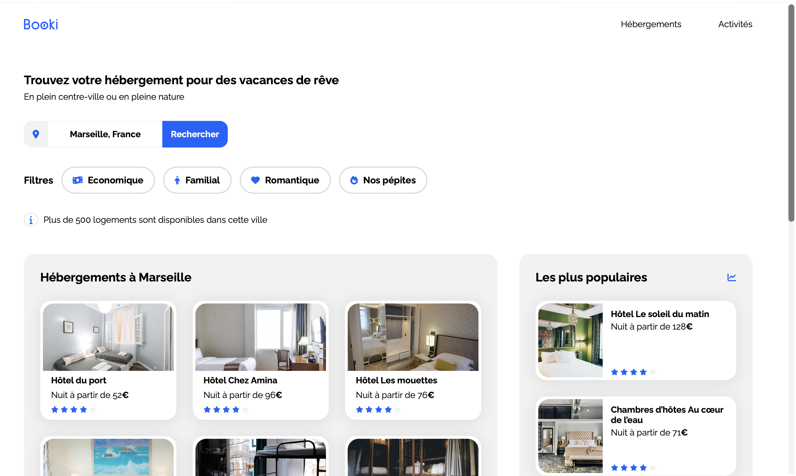
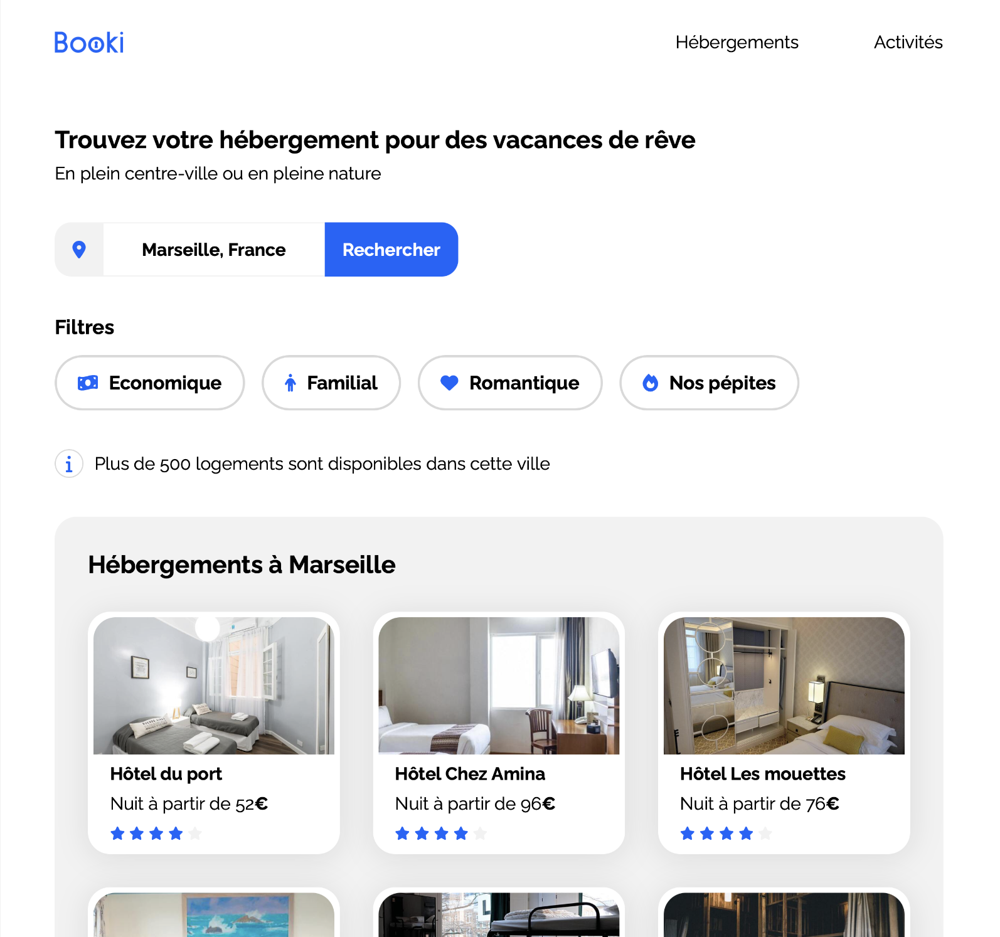
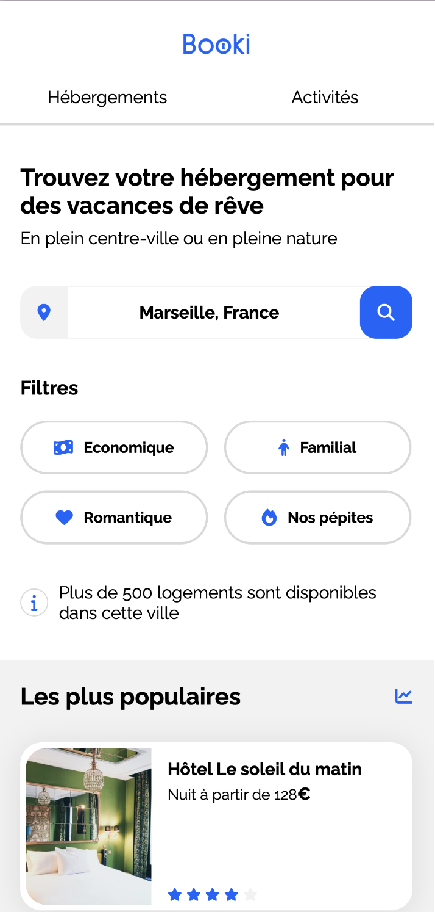

# Booki : page d'accueil d'une agence de voyage
 
Intégration en **HTML et CSS purs** de la page d'accueil de **Booki**, une agence de voyage en ligne qui permet de trouver un hébergement et des activités dans la ville de son choix.
 
Ce projet est réalisé dans le cadre du **projet 2 de la formation Développeur Web d'OpenClassrooms**, à partir d'une maquette Figma (desktop, tablette et mobile).
 
---
 
## Aperçu
 
### Desktop
 

 
### Tablette et mobile
 
<p>
  
  &nbsp;
  
</p>

---

## Sommaire

- [Fonctionnalités](#fonctionnalités)
- [Stack technique](#stack-technique)
- [Prérequis](#prérequis)
- [Installation et lancement](#installation-et-lancement)
- [Structure du projet](#structure-du-projet)
- [Choix techniques](#choix-techniques)
- [Responsive](#responsive)
- [Accessibilité](#accessibilité)
- [Qualité du code](#qualité-du-code)
- [Compatibilité](#compatibilité)
- [Crédits](#crédits)
- [Auteur](#auteur)

---

## Fonctionnalités

- **Header** avec logo et navigation : les liens *Hébergements* et *Activités* mènent aux sections correspondantes de la page (ancres).
- **Formulaire de recherche** de destination (non fonctionnel, intégration visuelle uniquement).
- **Filtres** (Économique, Familial, Romantique, Nos pépites) avec un changement de couleur au survol.
- **Hébergements à Marseille** : 6 cartes cliquables (photo, nom, prix, note).
- **Les plus populaires** : 3 cartes mises en avant.
- **Activités à Marseille** : 4 cartes cliquables.
- **Footer** en 3 colonnes de liens.
- **Mise en page responsive** sur 3 formats : desktop, tablette et mobile.

> Les liens et le formulaire ne sont pas reliés à un back-end : il s'agit d'une intégration statique.

---

## Stack technique

| Technologie | Utilisation |
|---|---|
| **HTML5** | Structure sémantique de la page |
| **CSS3** | Mise en forme, Flexbox, variables CSS, media queries |
| **[Font Awesome 6.2.1](https://fontawesome.com/)** | Icônes (chargées via CDN) |
| **[Google Fonts : Raleway](https://fonts.google.com/specimen/Raleway)** | Police du projet (chargée via CDN) |
| **[Figma](https://www.figma.com/)** | Maquettes de référence |
| **Git et GitHub** | Versionnement du code |

Aucun framework, aucune bibliothèque CSS et aucun JavaScript : le projet repose uniquement sur HTML et CSS.

---

## Prérequis

- Un **navigateur récent** : Google Chrome ou Mozilla Firefox (dernières versions).
- **[Git](https://git-scm.com/)** pour cloner le dépôt.
- Une **connexion Internet**, pour charger la police Raleway et les icônes Font Awesome depuis leur CDN.
- *Optionnel :* **[VS Code](https://code.visualstudio.com/)** 

Aucune installation de dépendances n'est nécessaire (pas de `npm install`).

---

## Installation et lancement

### 1. Cloner le dépôt

```bash
git clone https://github.com/Autumn-Git/Projet-2-Booki.git
```

### 2. Lancer le projet

Ouvrir le fichier `index.html` dans votre navigateur (double-clic ou glisser-déposer).


### 3. Tester le responsive

Ouvrir les outils de développement du navigateur (`F12`, ou `Cmd + Option + I` sur Mac), puis activer la **vue appareil** pour tester les largeurs **1440, 1024, 768, 767 et 375 px**.

---

## Structure du projet

```
Projet-2-Booki/
├── index.html          # Page d'accueil
├── css/
│   └── style.css       # Feuille de style unique (desktop first + media queries)
├── images/
│   ├── logo/           # Logo Booki
│   ├── hebergements/   # Photos des cartes hébergements
│   ├── activites/      # Photos des cartes activités
│   └── screen/         # Photos du sites
├── companion/          # Fichiers de l'assistant pédagogique fournis par OpenClassrooms
├── agents.md           # Configuration de l'assistant pédagogique (OpenClassrooms)
├── .gitignore
└── README.md
```

---

## Choix techniques

- **Desktop first** : les styles de base correspondent à la version desktop, puis des media queries adaptent l'affichage aux écrans plus petits.
- **Flexbox** pour toute la mise en page (header, filtres, grilles de cartes, footer).
- **Variables CSS** (`:root`) pour les couleurs de la charte, afin de les modifier à un seul endroit :

  | Variable | Couleur | Usage |
  |---|---|---|
  | `--main-color` | `#0065FC` | Couleur principale (liens, icônes, bouton) |
  | `--main-bg-color` | `#F2F2F2` | Fonds gris (sections, footer) |
  | `--filter-bg-color` | `#DEEBFF` | Fond des filtres au survol |
  | `--border-color` | `#D9D9D9` | Bordures |
  | `--white` | `#FFFFFF` | Fond de section

- **Largeur maximale** du contenu fixée à **1440 px**.

---

## Responsive

| Format | Largeur | Principales adaptations |
|---|---|---|
| **Desktop** | > 1024 px | Hébergements et Populaires côte à côte, 4 activités sur une ligne, footer en 3 colonnes |
| **Tablette** | 768 px à 1024 px | Populaires sous les Hébergements, cartes populaires sur une ligne, filtres sous leur titre |
| **Mobile** | < 768 px | Une colonne, Populaires affichés avant les Hébergements, header centré avec onglets, bouton de recherche en icône loupe, filtres deux par deux, footer pleine largeur et colonnes empilées |

---

## Accessibilité

- Balises **sémantiques** : `header`, `nav`, `main`, `section`, `article`, `aside`, `footer`, `form`.
- Hiérarchie de titres cohérente (`h1`, `h2`, `h3`).
- **Texte alternatif** (`alt`) sur toutes les images.
- Icônes décoratives masquées aux lecteurs d'écran avec `aria-hidden="true"`.
- Attribut `lang="fr"` sur la page.

---

## Qualité du code

Le code doit passer sans erreur les validateurs du W3C :

- HTML : [validator.w3.org](https://validator.w3.org)
- CSS : [jigsaw.w3.org/css-validator](https://jigsaw.w3.org/css-validator/)

---

## Compatibilité

Testé sur les dernières versions de **Google Chrome**, **Mozilla Firefox** et **Safari**.

---

## Crédits

- **Maquettes et ressources graphiques** (logo, photographies) : fournies par [OpenClassrooms](https://openclassrooms.com/) dans le cadre de la formation.
- **Icônes** : [Font Awesome](https://fontawesome.com/).
- **Police** : [Raleway](https://fonts.google.com/specimen/Raleway), via Google Fonts.

---

## Auteur

**Autumn-Git** : [github.com/Autumn-Git](https://github.com/Autumn-Git)

Projet réalisé dans le cadre de la formation **Développeur Web** d'OpenClassrooms.

> Ce projet a une vocation pédagogique et n'est pas destiné à un usage commercial.